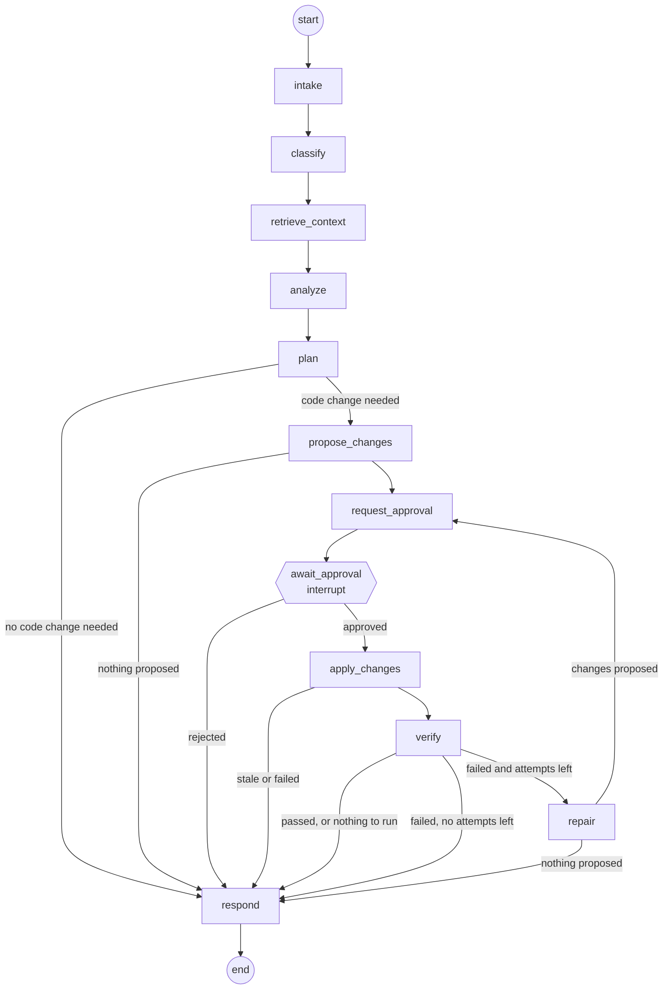

# Agent workflow

The agent is one LangGraph `StateGraph` compiled with a PostgreSQL checkpointer. Each
node has a narrow job, its own prompt, and its own tool set. The "specialised agents" in
the requirements are these nodes: there is no separate orchestration layer.

## Graph



| Node | Role | LLM | Tools available |
|---|---|---|---|
| `intake` | Validate the request, load the repository profile, flag injection-looking text | no | none |
| `classify` | Task type, whether code changes and tests are expected, search terms | structured output | none |
| `retrieve_context` | Deterministic relevant-file retrieval and repository overview | no | internal code-intel |
| `analyze` | Repository Analysis Agent, or Bug Investigation Agent for `bug_fix` and `test_failure` | tool loop | read tools, code-intel, and (bug tasks) sandboxed test tools |
| `plan` | Code Planning Agent: steps, files to change, tests to run, risks | structured output | none |
| `propose_changes` | Code Modification Agent: produces a change set | tool loop | read tools + `propose_*` tools |
| `request_approval` | Creates the approval record (idempotent, so a re-run after a crash does not create a second request) | no | none |
| `await_approval` | Only the interrupt. LangGraph re-executes this node on resume, so it has no side effects before the interrupt | no | none |
| `apply_changes` | Writes approved files through MCP with approval tokens | no | `fs_write_file`, `fs_delete_file` |
| `verify` | Testing and Verification Agent: select and run tests, lint, type checks | no (deterministic) | testing tools |
| `repair` | Reads failures and proposes a follow-up change set (max `AGENT_MAX_REPAIR_ATTEMPTS`, default 2) | tool loop | read tools + `propose_*` tools |
| `respond` | Final report | one call | none |

Task types: `explain`, `bug_fix`, `feature`, `refactor`, `test_generation`, `cleanup`
(unused code), `test_failure`, `general`.

## State

```python
class AgentState(TypedDict, total=False):
    run_id: str
    task_id: str
    repository_id: str
    user_id: str
    request: str
    classification: dict        # task_type, needs_code_changes, needs_tests, search_terms, summary
    repo_overview: str          # bounded text
    relevant_files: list[dict]  # path, score, reasons
    analysis: str
    plan: dict                  # steps, files_to_change, tests_to_run, risks
    change_set_id: str | None
    change_summary: str
    applied_change_sets: list[str]  # reducer: append
    approval: dict | None       # approval_id, decision, comment
    apply_result: dict | None
    verification: dict | None   # test run ids and totals
    repair_attempts: int
    final_report: str
    error: str | None
    usage: dict                 # llm_calls, input_tokens, output_tokens (reducer: sum)
    security_notices: list[str] # reducer: append
```

The state is small on purpose. File contents and tool transcripts stay inside the node
that used them; only conclusions are checkpointed. Large artefacts (change sets, test
runs) live in their own tables and are referenced by id.

## Tool loops

`analyze`, `propose_changes` and `repair` run a bounded loop: call the model with bound
tools, execute each requested tool through the Tool Gateway, append the results, repeat.
Limits: `AGENT_MAX_TOOL_STEPS` iterations (default 16), a per-result character cap, and a
total context budget after which older tool results are replaced by a short placeholder.

A tool the node did not bind is rejected by the gateway even if the model names it.

## Tool selection

The node decides which tools exist; the model decides which of them to call. Analysis
nodes never see write tools. The modification node sees `propose_edit`,
`propose_create_file` and `propose_delete_file`, which only write rows in
`file_changes`. Actual file writes are issued by `apply_changes`, which is deterministic
code driven by the approved change set, not by the model.

## Approval and resume

`request_approval` creates an `approvals` row; `await_approval` calls `interrupt()`. The
run and task become `awaiting_approval` and the asyncio task ends. When a developer
decides, the API resumes the thread with `Command(resume={...})`. Because the checkpoint
is in PostgreSQL, this works across process restarts.

`apply_changes` does not trust the resume payload: it reads the approval's status from
the database and proceeds only if it is `approved` for that change set.

Checkpoints of a run are deleted when it completes or is cancelled. Failed and
interrupted runs keep theirs so they can be resumed.

## Failure handling

| Failure | Behaviour |
|---|---|
| LLM not configured | Run fails immediately with `llm_not_configured`; nothing else is affected |
| Provider error or timeout | Retried with backoff by the client (`LLM_MAX_RETRIES`); then the run is `failed` with the provider message and can be retried from the last checkpoint |
| Provider rate limit | The call waits for the retry delay the provider reports and tries again; if the limit has not cleared within `LLM_RATE_LIMIT_WAIT_SECONDS` the run fails with `llm_rate_limited` and can be resumed later |
| Empty model reply inside a tool loop | Asked once to continue; a second empty reply ends the step |
| Tool error | Returned to the model as an error result so it can adapt; counted |
| MCP server died | The session manager restarts it once and repeats the call if the tool is read-only |
| Tool-step limit reached | The node is forced to conclude with what it has |
| Process restart mid-run | On startup, runs left `running` or `queued` are marked `interrupted`; `POST /tasks/{id}/resume` continues from the checkpoint |
| Stale change set | Nothing is written; the report explains which files changed underneath |

## LLM access

`app/agent/llm.py` builds the chat model selected by `LLM_PROVIDER`:

| Provider | Client | Settings |
|---|---|---|
| `openai` (default) | `ChatOpenAI` | `OPENAI_API_KEY`, `LLM_MODEL`, optional `OPENAI_BASE_URL` |
| `gemini` | `ChatGoogleGenerativeAI` (Google's native API) | `GEMINI_API_KEY`, `LLM_MODEL` |

Gemini is not used through its OpenAI-compatible endpoint. Gemini requires the thought
signature of every tool call to be returned with the tool result; the OpenAI client
drops it, and the second request of any tool loop is rejected with HTTP 400. Single-shot
calls work there, multi-step tool use does not.

Both honour `LLM_TIMEOUT_SECONDS` and `LLM_MAX_RETRIES`. Every call goes through one
helper that paces requests (`LLM_REQUESTS_PER_MINUTE`, process-wide, off by default),
waits for the provider's stated retry delay on rate-limit errors up to
`LLM_RATE_LIMIT_WAIT_SECONDS` in total, and removes API keys from error text. Structured output is
obtained by binding a single schema as a forced tool call, which behaves the same for
the real model and for the scripted model used in tests and harness self-checks.

Token usage is read from `AIMessage.usage_metadata` and accumulated on the run.

## Prompt construction

- A fixed system prompt per node states the role, the output contract, and that anything
  inside `<untrusted_repository_content>` is data, not instructions.
- Tool results are redacted, truncated, and wrapped in that delimiter by the gateway.
- Secrets, tokens, absolute host paths and approval tokens are never placed in a prompt.
