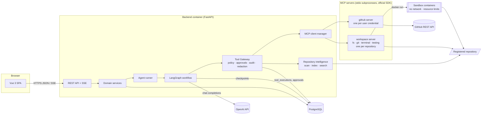
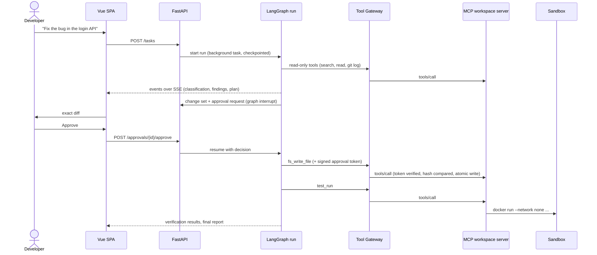
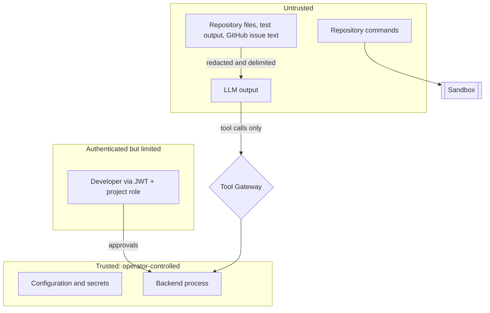

# Architecture

ASEA (Autonomous Software Engineering Agent) lets a developer register a local Git
repository, ask for development work in natural language, and have an agent explore the
code, plan, propose changes, apply them after approval, run tests, and report.

This document describes the whole system. Detailed designs live in the sibling documents:
[database-design.md](database-design.md), [api-documentation.md](api-documentation.md),
[mcp-tools.md](mcp-tools.md), [agent-workflow.md](agent-workflow.md),
[security.md](security.md), [testing.md](testing.md), [deployment.md](deployment.md).

## 1. Design principles

1. **Permissions are enforced outside the model.** The LLM only ever emits tool calls.
   Every call passes through the Tool Gateway (policy, approval check, logging) and then
   through the MCP server's own checks (path confinement, command policy, approval-token
   verification). The model cannot grant itself anything.
2. **Repository content is untrusted input.** It is redacted, delimited, and never able
   to change what tools are permitted. Repository commands run in a sandbox.
3. **Nothing mutates the developer's work without an explicit, recorded approval.**
   Changes are proposals stored in the database until a human approves the exact diff.
4. **One graph, specialised nodes.** A single LangGraph workflow with role-specific
   prompts and tool sets, instead of a fleet of independently orchestrated agents.
5. **Durable state.** Everything the UI shows comes from PostgreSQL; agent runs are
   checkpointed so they survive restarts and wait indefinitely for approval.
6. **Few moving parts.** PostgreSQL only (no MongoDB, Redis, or task queue), no vector
   database, no frontend component framework.

## 2. System overview



### Components

| Component | Responsibility | Location |
|---|---|---|
| REST API | Auth, CRUD, task submission, approvals, streaming of run events | `backend/app/api` |
| Domain services | Business rules, transactions, audit logging | `backend/app/services` |
| Repository intelligence | Scan, language/framework detection, symbol index, search, context packs, unused-code analysis | `backend/app/repo_intel` |
| Agent | LangGraph state machine, prompts, LLM access, run lifecycle | `backend/app/agent` |
| Tool Gateway | The only path from the agent (or API) to a tool: policy, approval, token minting, redaction, logging | `backend/app/mcp_client/gateway.py` |
| MCP client manager | Spawns, caches, health-checks and restarts MCP server sessions | `backend/app/mcp_client/manager.py` |
| MCP server | Filesystem, Git, terminal, testing, and GitHub tools built on `mcp.server.mcpserver.MCPServer` | `backend/app/mcp_server` |
| Sandbox | Runs repository commands in throwaway Docker containers (or a restricted local subprocess) | `backend/app/sandbox` |
| Security primitives | Path confinement, command policy, secret redaction, injection heuristics, approval tokens, JWT, credential encryption | `backend/app/security` |
| Evaluation | Dataset, harness and metrics | `backend/app/evaluation` |
| Frontend | Vue 3 + TypeScript SPA | `frontend/` |

## 3. Request lifecycle



## 4. Key decisions

| Decision | Choice | Reason |
|---|---|---|
| Python runtime | 3.12 (uv-managed venv; `python:3.12-slim` in Docker) | SQLAlchemy 2.1, LangChain 1.x and pydantic-settings require ≥ 3.11; the host only ships 3.10 |
| Database | PostgreSQL 18 only | All data is relational; JSONB covers semi-structured payloads. No requirement justifies MongoDB |
| DB driver | psycopg 3 (async) for both SQLAlchemy and the LangGraph checkpointer | One driver instead of asyncpg + psycopg |
| Background work | In-process asyncio tasks + durable checkpoints | Avoids Celery/Redis. A restarted process marks orphaned runs `interrupted` and they can be resumed |
| Human approval | LangGraph `interrupt()` + `AsyncPostgresSaver` | Runs pause for arbitrarily long without holding resources |
| MCP SDK | `mcp` 2.x (`MCPServer`, `Client`) | Current official SDK; v1 `FastMCP` no longer exists |
| MCP transport | stdio subprocess per repository; streamable HTTP available for external clients | The workspace root is fixed at spawn time, so the model can never name another repository; the child gets a scrubbed environment |
| Code search | Deterministic index in PostgreSQL + lexical scoring | No embedding API calls on private code, no vector DB. Embeddings are a possible later extension |
| Symbol extraction | Python `ast`; regex heuristics for JS/TS/Vue | No native parser dependency. Limits are documented in `testing.md` |
| Sandbox | Docker container per command (`--network none`, memory/CPU/pids limits, read-only root, non-root user) with a restricted local-process fallback | Strongest isolation available without extra infrastructure |
| LLM | OpenAI through `langchain-openai`; model name is required configuration | Stack requirement. No model default is guessed |
| Frontend | Vue 3, TypeScript 6.0, Vite 8, Pinia, Vue Router, Tailwind 4, Material Design Icons; the visual design is the Digitory Reservation portal's design system (see progress.md) | TypeScript is held at 6.0 because `typescript-eslint` does not yet support 7 |
| Diff viewer | Own component rendering unified diffs | Avoids a dependency for a small, well-defined job |
| Progress streaming | SSE backed by the `agent_events` table, with polling fallback | Survives reconnects and restarts; no in-memory pub/sub |
| Git access | The `git` CLI with a hardened configuration (`app/security/gitsafe.py`) | Hooks, fsmonitor, external diff, textconv, pagers and credential helpers are disabled on every call; repositories whose own config can execute programs are refused at registration |

## 5. Trust boundaries



Secrets (JWT key, approval-token key, credential-encryption key, OpenAI key, GitHub
tokens) never enter a prompt, a tool result, a log line, or the workspace MCP server's
environment.

## 6. Project layout

```
.
├── README.md
├── docker-compose.yml          # db, backend, frontend
├── .env.example
├── docker/
│   ├── sandbox.Dockerfile      # image used for sandboxed commands
│   └── sandbox-entrypoint.sh
├── docs/
├── backend/
│   ├── pyproject.toml
│   ├── alembic.ini
│   ├── alembic/versions/
│   ├── Dockerfile
│   ├── requirements.lock       # exact versions used by the image
│   ├── app/
│   │   ├── main.py             # app factory, lifespan, middleware
│   │   ├── config.py           # pydantic-settings
│   │   ├── logs.py             # structlog, with secret redaction
│   │   ├── errors.py           # error types and handlers
│   │   ├── db/                 # engine, session, ORM models
│   │   ├── schemas/            # request/response models
│   │   ├── api/                # dependencies and routers
│   │   ├── security/           # auth, paths, commands, redaction, injection, approval tokens, gitsafe
│   │   ├── services/           # domain services
│   │   ├── repo_intel/         # workspace (confined file access), detect, symbols, indexer, search, unused
│   │   ├── runtime.py          # process-wide services: MCP sessions, gateway, agent runner
│   │   ├── sandbox/            # docker and local runners
│   │   ├── mcp_server/         # MCP server and tools
│   │   ├── mcp_client/         # session manager, gateway, tool policy
│   │   ├── agent/              # state, graph, nodes, prompts, llm, runner
│   │   └── evaluation/         # dataset, harness, metrics
│   └── tests/
└── frontend/
    ├── Dockerfile
    ├── nginx.conf
    └── src/
        ├── api/                # typed client
        ├── stores/             # Pinia
        ├── components/         # reusable UI
        ├── views/              # the twelve screens
        └── router/
```

## 7. Runtime topology

Development: `docker compose up db` for PostgreSQL (host port 55432), backend with
`uvicorn --reload`, frontend with `vite` (proxying `/api`).

Docker Compose deployment: `db`, `backend`, `frontend` (nginx serving the SPA and
proxying `/api`). The backend mounts the repositories directory and the Docker socket so
it can start sandbox containers. See [deployment.md](deployment.md) for the implications
of the socket mount and the GCP layout.

## 8. Frontend

Vue 3 single-page application (`frontend/src`).

| Screen | Route | Backing endpoints |
|---|---|---|
| Dashboard | `/` | `/dashboard/summary` |
| Projects & repositories | `/projects` | `/projects`, `/projects/{id}/members`, `/projects/{id}/repositories`, `/repositories/{id}/index` |
| Developer assistant | `/assistant` | `POST /tasks`, `/tasks` |
| Task detail (progress, analysis and plan, report) | `/tasks/:id` | `/tasks/{id}`, `/runs/{id}/stream`, `/runs/{id}/events`, `/approvals`, `/change-sets`, `/test-runs` |
| Code analysis | `/code` | `/repositories/{id}/context`, `tree`, `file`, `symbols`, `search`, `relevant-files`, `routes`, `unused-code` |
| Change review and diff viewer | `/changes`, `/changes/:id` | `/change-sets`, `/change-sets/{id}`, `staleness`, `revert` |
| Approvals | `/approvals` | `/approvals`, `approve`, `reject` |
| Tests & checks | `/tests` | `/repositories/{id}/tests/discover`, `/repositories/{id}/test-runs`, `/test-runs` |
| MCP & tool activity | `/mcp` | `/mcp/servers`, `/mcp/tools`, `/tool-executions` |
| Git & GitHub | `/github` | `/repositories/{id}/git/*`, `/github/*` |
| Execution history | `/history` | `/tasks`, `/audit-logs` |
| Settings & permissions | `/settings` | `/settings/system`, `/github/credential`, `/users` |

Shared pieces: `AppShell` (navigation, project and repository selection, pending-approval
badge), `AsyncBlock` (loading, error and empty states), `DiffViewer`, `ApprovalPanel`,
`RunTimeline`, `TestCounts`, `StatusBadge`, `MarkdownView`, `NoticeBox`, `PageHeader`.
State lives in two Pinia stores (`auth`, `workspace`); everything else is fetched per
screen. Tokens are kept in `sessionStorage` and refreshed once on a 401.

Every figure shown comes from an API response. When a capability is unavailable (no LLM
key, no GitHub token, sandbox in local mode, dependencies not installed) the interface
says so instead of showing a placeholder result.
