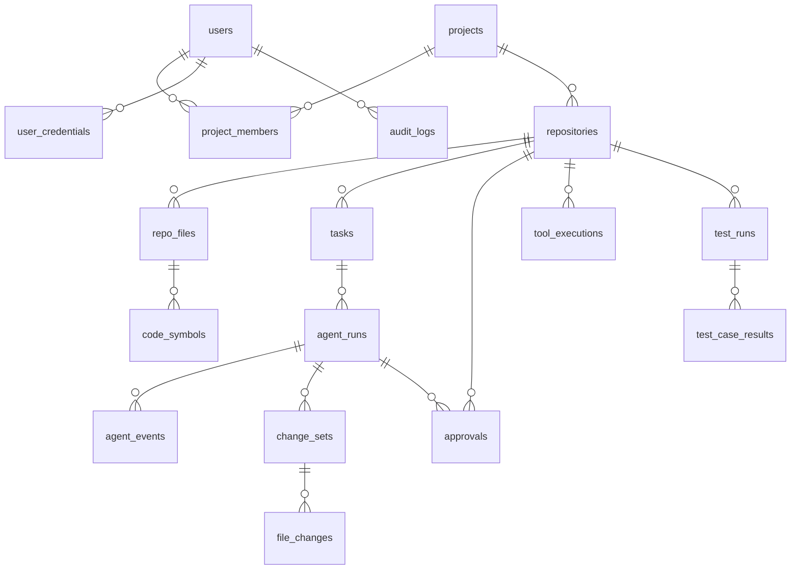

# Database design

PostgreSQL 18. ORM: SQLAlchemy 2.1 (async, psycopg 3). Migrations: Alembic
(`backend/alembic/versions`). All primary keys are UUIDs except the append-only
`agent_events` table, which uses a `bigint` identity so it can serve as a stream cursor.
Timestamps are `timestamptz` in UTC.

MongoDB is not used: every entity is relational and JSONB covers the variable payloads.

## Relationships



## Tables

### users
| Column | Type | Notes |
|---|---|---|
| id | uuid PK | |
| email | varchar(320) unique | stored lower-case |
| full_name | varchar(200) | |
| password_hash | varchar(255) | Argon2id |
| role | varchar(20) | `admin`, `developer`, `viewer` |
| is_active | bool | |
| created_at, updated_at | timestamptz | |

### user_credentials
Encrypted third-party credentials. Unique `(user_id, provider)`.

| Column | Type | Notes |
|---|---|---|
| id | uuid PK | |
| user_id | uuid FK users, cascade | |
| provider | varchar(30) | `github` |
| encrypted_secret | text | Fernet ciphertext; never returned by the API |
| hint | varchar(20) | last four characters, for display |
| meta | jsonb | login, token expiry reported by GitHub |
| created_at, updated_at | timestamptz | |

### projects
`id`, `name` (unique per owner), `description`, `owner_id` FK users, `settings` jsonb
(`auto_run_tests`), timestamps.

### project_members
PK `(project_id, user_id)`; `role` is `owner`, `developer` or `viewer`.

### repositories
| Column | Type | Notes |
|---|---|---|
| id | uuid PK | |
| project_id | uuid FK projects, cascade | |
| name | varchar(200) | |
| local_path | text | canonical, inside an allowed root; unique per project |
| default_branch | varchar(255) | |
| remote_url | text | credentials stripped |
| github_full_name | varchar(255) | `owner/name` when the remote is GitHub |
| status | varchar(20) | `registered`, `indexing`, `ready`, `error` |
| profile | jsonb | languages, frameworks, dependencies, package managers, test frameworks, entry points |
| head_commit | varchar(64) | commit at last index |
| last_indexed_at | timestamptz | |
| index_error | text | |

### repo_files
Unique `(repository_id, path)`.
`id`, `repository_id`, `path`, `language`, `size_bytes`, `line_count`, `content_hash`
(sha256), `is_test`, `is_binary`, `indexed_at`.

### code_symbols
Index `(repository_id, name)` and `(file_id)`.
`id`, `repository_id`, `file_id`, `name`, `qualified_name`, `kind` (`function`, `class`,
`method`, `route`, `component`, `import`, `variable`), `start_line`, `end_line`,
`signature`, `extra` jsonb (HTTP method and path for routes, exported flag, imported
names).

### tasks
| Column | Type | Notes |
|---|---|---|
| id | uuid PK | |
| project_id, repository_id | uuid FK | |
| created_by | uuid FK users | |
| title | varchar(300) | |
| request_text | text | the natural-language request |
| task_type | varchar(40) | set by classification |
| status | varchar(30) | `queued`, `running`, `awaiting_approval`, `completed`, `failed`, `cancelled`, `interrupted` |
| dedupe_key | varchar(64) | sha256 of repository + normalised request |
| result_summary | text | |

Partial unique index on `(repository_id, dedupe_key)` where status is `queued`,
`running`, `awaiting_approval` or `interrupted`: duplicate active tasks are rejected by
the database, not only by application code.

### agent_runs
`id`, `task_id`, `thread_id` (LangGraph thread), `status` (same values as tasks),
`current_node`, `classification` jsonb, `analysis` text, `plan` jsonb, `final_report`
text, `error` text, `llm_calls`, `input_tokens`, `output_tokens`, `repair_attempts`,
`started_at`, `finished_at`, `heartbeat_at`.

### agent_events
Append-only execution history and the source for SSE.
`id` bigint identity PK, `run_id`, `type` (`run_started`, `node_started`,
`node_finished`, `llm_call`, `tool_call`, `approval_requested`, `approval_decided`,
`change_set_created`, `test_run`, `security_notice`, `error`, `run_finished`), `node`,
`payload` jsonb, `created_at`. Index `(run_id, id)`.

### change_sets
`id`, `run_id` (nullable), `task_id`, `repository_id`, `title`, `summary`, `status`
(`draft` while the agent is still proposing, `proposed`, `approved`, `rejected`, `applied`, `stale`, `failed`, `reverted`,
`partially_reverted`), `base_commit`, `created_at`, `decided_at`, `applied_at`.

### file_changes
| Column | Type | Notes |
|---|---|---|
| id | uuid PK | |
| change_set_id | uuid FK, cascade | |
| path | text | repository-relative |
| change_type | varchar(10) | `create`, `modify`, `delete` |
| base_hash | varchar(64) | sha256 of the file when proposed; null for `create` |
| original_content | text | kept for recovery |
| new_content | text | null for `delete` |
| new_hash | varchar(64) | |
| diff | text | unified diff shown to the reviewer |
| status | varchar(20) | `pending`, `applied`, `stale`, `failed`, `reverted`, `revert_conflict` |
| error | text | |

### approvals
| Column | Type | Notes |
|---|---|---|
| id | uuid PK | |
| repository_id | uuid FK | |
| task_id, run_id, change_set_id | uuid FK, nullable | |
| action_type | varchar(40) | `apply_changes`, `revert_changes`, `install_dependencies`, `run_migration`, `sensitive_command`, `run_tests`, `git_create_branch`, `git_commit`, `git_push`, `github_create_pr` |
| title | varchar(300) | |
| payload | jsonb | exactly what will be executed |
| payload_hash | varchar(64) | detects tampering between request and execution |
| status | varchar(20) | `pending`, `approved`, `rejected`, `executed`, `failed`, `expired`, `cancelled` |
| requested_by_user_id | uuid, nullable | null when the agent asked |
| decided_by | uuid FK users | |
| decided_at | timestamptz | |
| comment | text | |
| result | jsonb | execution outcome |
| expires_at | timestamptz | |

### tool_executions
`id`, `run_id`, `repository_id`, `user_id`, `approval_id` (all nullable FKs), `server`
(`workspace`, `github`, `internal`), `tool_name`, `risk_level` (`read`, `execute`,
`write`, `sensitive`), `arguments` jsonb (redacted, truncated), `status` (`success`,
`error`, `denied`, `timeout`), `result_preview` text (redacted, truncated), `error`,
`duration_ms`, `created_at`. Indexes on `(repository_id, created_at)` and `(run_id)`.

### test_runs
`id`, `repository_id`, `task_id`, `run_id`, `triggered_by`, `kind` (`unit`,
`integration`, `lint`, `typecheck`, `build`), `framework`, `command` jsonb (argv),
`targets` jsonb, `status` (`passed`, `failed`, `error`, `timeout`, `not_executed`),
`passed`, `failed`, `skipped`, `errors`, `not_executed` counters, `duration_ms`,
`output_excerpt`, `created_at`.

### test_case_results
`id`, `test_run_id` (cascade), `node_id`, `file`, `name`, `outcome` (`passed`, `failed`,
`skipped`, `error`, `not_executed`), `duration_ms`, `message`.

### audit_logs
`id`, `actor_user_id` (nullable), `actor_type` (`user`, `agent`, `system`), `action`
(dotted, e.g. `approval.approve`, `security.path_denied`), `resource_type`,
`resource_id`, `details` jsonb, `ip_address`, `created_at`. Never updated or deleted by
the application.

### LangGraph checkpoint tables
`checkpoints`, `checkpoint_blobs`, `checkpoint_writes`, `checkpoint_migrations` are
created and migrated by `AsyncPostgresSaver.setup()` at startup, not by Alembic, because
their schema belongs to the library. Alembic is configured to ignore them.

## Migrations

```
cd backend
alembic upgrade head                              # apply
alembic revision --autogenerate -m "message"      # create
```

The container entrypoint runs `alembic upgrade head` before starting the API.
